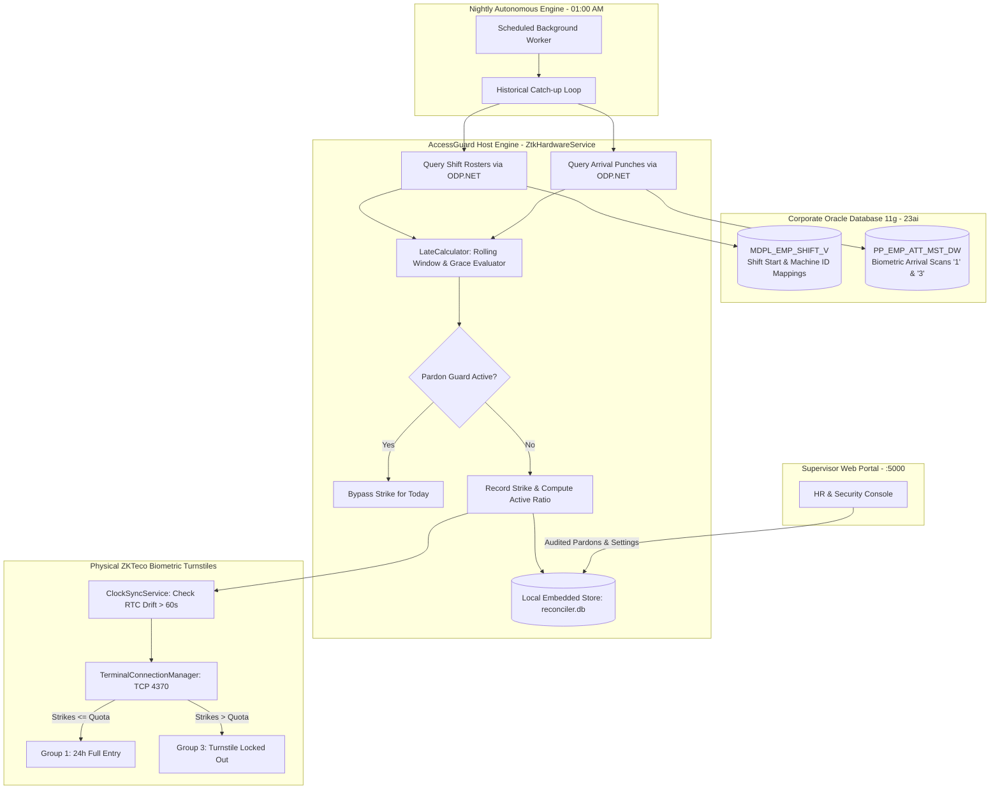

<div align="center">


# AccessGuard™
### Enterprise Biometric Attendance Reconciler & Hardware Access Controller
**Autonomous Turnstile Tardiness Enforcement • Oracle ERP Bridge • Zero-Friction Facility Security**

[](https://microsoft.com)
[](https://dotnet.microsoft.com)
[](https://oracle.com)
[](https://zkteco.com)
[](#)
[](#-proprietary-licensing--purchasing-information)

<br/>

<a href="https://release-iwbr0fq6o-junaiddbzs-projects.vercel.app/" target="_blank">
  
</a>

<br/><br/>

<p align="center">
  <b>Developed & Engineered by</b><br/>
  <a href="#-about-the-developer">
    <picture>
      <source media="(prefers-color-scheme: dark)" srcset="docs/company_logo_white.png">
      <source media="(prefers-color-scheme: light)" srcset="docs/company_logo_dark.png">
      
    </picture>
  </a><br/>
  <i>Delivering high-reliability enterprise software, infrastructure, and digital engineering solutions.</i>
</p>

</div>

---

## 📑 Navigation
- [PART I: EXECUTIVE & COMMERCIAL PITCH](#part-i-executive--commercial-pitch)
  - [The Enterprise Problem](#-the-enterprise-problem)
  - [The Solution: AccessGuard](#-the-solution-accessguard)
  - [Why Corporations Choose AccessGuard](#-why-corporations-choose-accessguard-core-value-pillars)
  - [Intelligent Non-Destructive Enforcement](#-intelligent-non-destructive-enforcement)
  - [The Financial & Operational ROI](#-financial--operational-roi)
  - [Commercial Licensing & Purchasing](#-proprietary-licensing--purchasing-information)
- [PART II: TECHNICAL ARCHITECTURE & DEPLOYMENT](#part-ii-technical-architecture--deployment)
  - [Architecture & Data Pipeline](#-system-architecture--data-pipeline)
  - [System Requirements](#-system-requirements)
  - [Package Distribution Contents](#-package-contents)
  - [Quick Deployment Guide](#-quick-deployment-guide)
  - [Oracle ERP Integration & DDL Specs](#-oracle-erp-integration--schema-specifications)
  - [Hardware Communication & Drift Sync](#-hardware-terminal-integration)
  - [Windows Service Operations](#-windows-service-management)
  - [Disaster Recovery & SQLite Backups](#-disaster-recovery--database-maintenance)
  - [Diagnostics & Troubleshooting Matrix](#-troubleshooting--diagnostic-matrix)

---

# PART I: EXECUTIVE & COMMERCIAL PITCH

## 🛑 The Enterprise Problem

In corporate headquarters, manufacturing plants, and high-security industrial facilities, enforcing employee punctuality is notoriously difficult and fraught with friction:

- **Unchecked Time Theft & Chronic Lateness**: Unmonitored late arrivals cost medium-to-large enterprises hundreds of productive workforce hours every month.
- **Manual HR Overhead**: HR teams waste days manually cross-referencing punch cards, arguing over grace periods, and issuing disciplinary letters that arrive weeks after infractions occurred.
- **Physical Security Disputes**: Security guards stationed at gates or turnstiles face confrontation when manually refusing entry to late staff.
- **Fragmented Systems**: Biometric turnstiles run on vendor hardware, while shift planning and payroll live in enterprise databases (Oracle ERP). Traditional setups lack real-time synchronization between the database and the physical turnstile barriers.

---

## ⚡ The Solution: AccessGuard™

**AccessGuard** is an autonomous, mission-critical Windows Service that creates an automated feedback loop between your **Oracle Attendance Database** and your physical **ZKTeco Biometric Turnstiles**.

Operating silently in the background, AccessGuard audits employee clock-in transactions against exact shift rosters every night. When an employee breaches corporate tardiness thresholds, AccessGuard **instantly reprograms the physical turnstiles via network**, withholding entry barriers without requiring a single minute of manual HR intervention.

```
┌─────────────────────────┐       ┌────────────────────────┐       ┌─────────────────────────┐
│       Oracle ERP        │       │   AccessGuard Engine   │       │     ZKTeco Hardware     │
│  (Shifts & Attendance)  │ ────► │ (Rolling Window Audit) │ ────► │ (Turnstile Door Relay)  │
│ MDPL_EMP_SHIFT_V        │       │ Autonomous Background  │       │ Group 1  ➔ Open Gate    │
│ PP_EMP_ATT_MST_DW       │       │ 01:00 AM Daily Run     │       │ Group 3  ➔ Barrier Locked│
└─────────────────────────┘       └────────────────────────┘       └─────────────────────────┘
```

---

## 💎 Why Corporations Choose AccessGuard: Core Value Pillars

### 1. 🔄 Configurable Rolling Penalty Window
Forget rigid "monthly reset" or unfair single-strike rules. AccessGuard features a strictly dynamic **Rolling Penalty Window** (e.g., 30 Days, 60 Days):
* Each late strike recorded against an employee has an individual expiration countdown.
* If an employee maintains punctuality, strikes **naturally fall off and expire**.
* The live HR dashboard displays a real-time countdown: `Window Expires: in 14 days`.

### 2. 🚦 The Three-Tier Progressive Discipline Engine
AccessGuard introduces predictable, transparent tiering so employees always understand their standing:
* 🟢 **Clear Tier** (`Strikes < Quota`): Normal physical turnstile access granted (Hardware Group 1).
* 🟡 **Warning Tier** (`Strikes == Quota`): Normal entry permitted, but flagged yellow in the dashboard—alerts managers that the employee is exactly 1 strike away from lockout.
* 🔴 **Locked Out Tier** (`Strikes > Quota`): The physical gate rejects entry (Hardware Group 3: Zero-Access Time Zone). The terminal beeps with *"Invalid Time Zone"*.

### 3. 🛡️ The "Pardon Guard" (Double-Penalty Shield)
When an emergency occurs (car breakdown, medical emergency), HR can grant an immediate **Pardon (Override)** from the web portal. 
* AccessGuard instantly pushes Group 1 to the gate, unlocking the turnstile within seconds.
* Crucially, the engine activates the **Pardon Guard**: a digital shield preventing the nightly reconciler from re-penalizing the employee for that same day's late punch, guaranteeing zero double-lockouts!

### 4. ⏱️ Automated Hardware Clock Drift Correction
Physical biometric turnstiles experience Real-Time Clock (RTC) drift over weeks of operation. If a terminal drifts by even 2 minutes, employees are unfairly penalized.
* AccessGuard monitors turnstile clocks against the authoritative server time.
* If drift exceeds **60 seconds**, AccessGuard automatically overwrites and recalibrates the turnstile RTC over the network before running reconciliations.

### 5. 🔁 Sequential Historical Catch-up
If your server experiences downtime over a holiday weekend or power outage:
* AccessGuard **never skips a day**.
* Upon boot, a sequential catch-up loop identifies the last processed date and reconciles every missed day in chronological order before processing today.

---

## 🔒 Intelligent Non-Destructive Enforcement

A major flaw of primitive access control solutions is deleting or disabling employee profiles on the turnstile. When a profile is disabled, the employee cannot scan—meaning their arrival attempt is lost, and HR has no legal audit record.

**AccessGuard solves this with Non-Destructive Hardware Grouping:**
* **Biometrics Remain Active**: The employee's face, fingerprint, and RFID badge remain fully registered on the hardware.
* **Punch Still Logged**: When they scan, the terminal recognizes their identity and writes the timestamp to Oracle.
* **Barrier Withheld**: The turnstile motor simply refuses to trip the entry relay because they belong to Access Group 3.
* **Result**: HR possesses undisputed proof that the employee arrived late and attempted entry, while unauthorized physical access is prevented!

---

## 📈 Financial & Operational ROI

| Operational Metric | Before AccessGuard | With AccessGuard |
|---|---|---|
| **HR Hours Spent Auditing Attendance** | 15–20 hours / week | **0 hours** (100% Autonomous) |
| **Punctuality Compliance Rate** | ~72% | **> 96%** within 30 days of deployment |
| **Disputes at Gate Security** | Daily confrontation | **Zero** (Objective automated policy) |
| **Time to Process Approved Exceptions** | 30–60 minutes of paperwork | **10 seconds** via Web Dashboard |
| **Audit Compliance Readiness** | Incomplete paper trails | **Instant CSV export with manager justification** |

---

## 💼 Proprietary Licensing & Purchasing Information

> **AccessGuard is a proprietary commercial enterprise software solution developed by Resolvent Technologies. Unauthorized reproduction, reverse-engineering, redistribution, or deployment is strictly prohibited.**

### Node-Locked Hardware Fingerprint (HWID)
To protect intellectual property and enterprise investments, AccessGuard utilizes an advanced **Hardware ID (HWID)** licensing system bound to the host server's physical **Motherboard** and **CPU** serial registers:
* Licenses are cryptographically signed and locked to your designated host server.
* Routine hardware upgrades (RAM expansions, GPU updates, SSD additions) will not invalidate your activation key.
* Cloning the system to unauthorized virtual machines or secondary servers will automatically lock the engine.

### How to Obtain an Activation License Key

```
┌───────────────────────┐      ┌─────────────────────────┐      ┌─────────────────────────┐
│ 1. Deploy Installer   │      │ 2. Retrieve Machine HWID │      │ 3. Instant Activation   │
│ Run Setup on server   │ ───► │ Open :5000/activation   │ ───► │ Submit Key & Unlock     │
│ Access Web Dashboard  │      │ Copy Hardware Signature │      │ Lifetime Enterprise Op  │
└───────────────────────┘      └─────────────────────────┘      └─────────────────────────┘
```

1. **Download & Install**: Deploy [`AccessGuard-Setup-v2.0.exe`](installer/AccessGuard-Setup-v2.0.exe) on your production server.
2. **Retrieve Machine Signature**: Open `http://localhost:5000` in your browser. Navigate to the **Activation** screen (or click the watermark footer) and copy your generated **Machine HWID**.
3. **Contact Resolvent Technologies**:
   * **Direct Inquiries / Sales**: [WhatsApp / Phone: +92 321 7345666](tel:+923217345666)
   * **Licensing Desk**: `sales@resolvent.tech` / `licensing@resolvent.tech`
   * **Company Website**: [https://resolvent.tech](https://resolvent.tech)
4. **Apply License Key**: Paste the cryptographically signed key into the dashboard to permanently unlock commercial operation.

---

<br/>

# PART II: TECHNICAL ARCHITECTURE & DEPLOYMENT

## 🏗️ System Architecture & Data Pipeline



---

## 💻 System Requirements

| Specification | Minimum Requirement | Production Recommended |
|---|---|---|
| **Operating System** | Windows 10 (64-bit) / Server 2016 | Windows 11 / Windows Server 2022 (x64) |
| **Framework Runtime** | Bundled / .NET 8.0 LTS | .NET 8.0 Hosting Bundle (Self-Contained in Setup) |
| **Memory (RAM)** | 2 GB Available | 4 GB+ Dedicated |
| **Disk Storage** | 500 MB Free Space | 2 GB NVMe SSD Free Space |
| **Database Compatibility** | Oracle 11g Release 2, 12c, 18c, 19c, 21c, 23ai (XE, SE2, EE) | Oracle Enterprise Edition 19c |
| **Biometric Terminals** | ZKTeco Standalone (TFT / SilkID / FaceDepot / SpeedFace Series) | Static IP with TCP Port 4370 Unfiltered |
| **Network Listener** | Inbound HTTP TCP Port 5000 (Configured automatically) | Dedicated Management LAN |

---

## 📦 Package Contents

The official release bundle is organized as follows:

```
Release_Package/
├── README.md                              # This master technical & commercial guide
├── .gitignore                             # Production Git exclusion rules (*.exe, *.db)
├── installer/
│   └── AccessGuard-Setup-v2.0.exe         # Production Inno Setup installer bundle (~40.3 MB)
├── docs/
│   ├── AccessGuard_User_Manual.html       # Interactive standalone HTML User Manual
│   ├── AccessGuard_Operator_Guide.md      # Administrator operational runbook
│   ├── app.ico                            # Official AccessGuard application icon
│   └── company_logo.png                   # Resolvent Technologies official mark
├── database/
│   └── Oracle_Required_Objects.sql        # Ready-to-execute Oracle DDL and verification tests
└── config/
    └── appsettings.example.json           # Sample host configuration template
```

---

## 🚀 Quick Deployment Guide

### Step 1: Execute the Installer
1. Right-click [`installer/AccessGuard-Setup-v2.0.exe`](installer/AccessGuard-Setup-v2.0.exe) and choose **Run as administrator**.
2. Follow the setup wizard prompts. The installer will:
   * Deploy the service to `C:\Program Files\AccessGuard\`.
   * Register the 64-bit ZKTeco COM components (`zkemkeeper.dll`) into the Windows Registry.
   * Install and start `ZtkHardwareService` as an auto-starting Windows Service.
   * Open TCP Port 5000 in Windows Firewall.
3. Once completed, your browser will automatically launch:
   ```
   http://localhost:5000
   ```

### Step 2: Configure via Web Dashboard (No JSON editing!)
All configurations are stored in an encrypted local SQLite database (`reconciler.db`) and hot-reload **instantly without restarting the Windows Service**:

1. **Set Admin Password**: Navigate to **Admin Users** and change default credentials (minimum 8-character policy).
2. **Connect Oracle**: Navigate to **Database Settings**. Enter your Oracle Host, Port (`1521`), Service Name, Username, and Password. Click **Test Connection** to confirm connectivity, then **Save**.
3. **Enroll Terminals**: Navigate to **Terminals**. Enter your ZKTeco device IP and Port (`4370`). The live heartbeat indicator will confirm **Online** status.
4. **Tune Policies**: Navigate to **Configuration Settings** to set your desired Grace Period, Rolling Window days, and Late Quota.

---

## 🗄️ Oracle ERP Integration & Schema Specifications

AccessGuard performs strictly **read-only queries** against two Oracle entities. Execute [database/Oracle_Required_Objects.sql](database/Oracle_Required_Objects.sql) to generate or map these views.

### 1. Shift Schedule Entity: `MDPL_EMP_SHIFT_V`
Maps physical biometric IDs to employee profiles and arrival schedules:
```sql
CREATE OR REPLACE VIEW MDPL_EMP_SHIFT_V AS
SELECT
    E.BIOMETRIC_ENROLL_ID   AS MACHINE_ID,       -- ZKTeco Enroll ID (e.g. '1042')
    E.EMP_CODE              AS EMPLOYEE_NUMBER,  -- Corporate Payroll Code
    TO_CHAR(S.START_TIME, 'HH24:MI') AS SHIFT_START, -- Format: '08:00'
    TO_CHAR(S.END_TIME,   'HH24:MI') AS SHIFT_END    -- Format: '17:00'
FROM HR_EMPLOYEES E
JOIN HR_SHIFTS S ON E.SHIFT_ID = S.SHIFT_ID;
```

### 2. Biometric Punch Entity: `PP_EMP_ATT_MST_DW`
Captures raw clock-in arrival events from the physical gates:
```sql
CREATE TABLE PP_EMP_ATT_MST_DW (
    AM_EMPNO   VARCHAR2(50)  NOT NULL, -- Matching MACHINE_ID
    AM_TIME    VARCHAR2(20)  NOT NULL, -- Format: 'YYYY/MM/DD HH24:MI' (e.g. '2026/10/11 08:04')
    AM_SHIFT   VARCHAR2(10)  NOT NULL  -- '1' = Check-In, '3' = Break-In (Lunch return)
);

CREATE INDEX IDX_PP_ATT_EMP_TIME ON PP_EMP_ATT_MST_DW (AM_TIME, AM_SHIFT, AM_EMPNO);
```

---

## 📡 Hardware Terminal Integration

* **Native SDK Protocol**: Communicates directly over TCP port `4370` using the 64-bit ZKTeco Standalone Communication SDK (`zkemkeeper.ZKEM.1`).
* **Resilient Concurrency**: If legacy payroll software or fingerprint upload utilities lock port 4370, AccessGuard enters an intelligent exponential-backoff retry loop to guarantee transaction delivery.
* **Access Group Commands**:
  * Pushes **Group 1** for authorized personnel (unrestricted 24h entry).
  * Pushes **Group 3** for locked-out personnel (zero-hour entry time zone).

---

## ⚙️ Windows Service Management

The engine runs as a native Windows Service named **`ZtkHardwareService`**. Manage it using PowerShell:

```powershell
# Check service health
Get-Service ZtkHardwareService

# Stop service
Stop-Service ZtkHardwareService

# Start service
Start-Service ZtkHardwareService

# Restart service
Restart-Service ZtkHardwareService

# View live application event logs
Get-EventLog -LogName Application -Source ZtkHardwareService -Newest 25
```

---

## 💾 Disaster Recovery & Database Maintenance

All system policies, registered users, strike histories, and pardon logs reside in:
```
C:\Program Files\AccessGuard\reconciler.db
```

### Automated Backup Script
Schedule this PowerShell command via Windows Task Scheduler to back up the SQLite database daily:

```powershell
$source = "C:\Program Files\AccessGuard\reconciler.db"
$backupDir = "\\CompanyBackupShare\AccessGuard"
$timestamp = Get-Date -Format "yyyyMMdd_HHmmss"
Copy-Item -Path $source -Destination "$backupDir\reconciler_$timestamp.db" -Force
```

To restore on a new machine: install AccessGuard via the setup wizard, stop the service, overwrite `reconciler.db` with your backup copy, and restart the service.

---

## 🔧 Troubleshooting & Diagnostic Matrix

| Issue | Root Cause | Solution |
|---|---|---|
| **Terminal Offline** | Network cable unplugged or IP mismatch | Ping the terminal IP from the server; verify port 4370 is open on your managed switches. |
| **Oracle Test Failed** | Bad credentials, listener down, or blocked port 1521 | Verify Oracle Listener (`lsnrctl status`); check database firewall; test credentials via SQL Developer. |
| **0 Punches Processed** | Non-matching table names or invalid time format | Verify views `MDPL_EMP_SHIFT_V` and `PP_EMP_ATT_MST_DW` exist. Ensure `AM_TIME` matches `YYYY/MM/DD HH24:MI`. |
| **Dashboard Inaccessible** | Service stopped or port 5000 in use | Check `Get-Service ZtkHardwareService`. Run `netstat -ano \| findstr :5000` to inspect port binding. |
| **Hardware Not Unlocking** | Terminal was offline during pardon | Confirm terminal network status. Click **Run Reconciler Now** on Dashboard to re-push pending access groups. |

---

## 🏢 About the Developer

<div align="center">
  <picture>
    <source media="(prefers-color-scheme: dark)" srcset="docs/company_logo_white.png">
    <source media="(prefers-color-scheme: light)" srcset="docs/company_logo_dark.png">
    
  </picture>
  <br/><br/>
  <h3>Resolvent Technologies</h3>
  <p><b>Enterprise Software • Industrial Automation • IT Infrastructure • Digital Transformation</b></p>
  <p>Contact: <a href="tel:+923217345666">+92 321 7345666</a> • Inquiries: <a href="mailto:info@resolvent.tech">info@resolvent.tech</a></p>
</div>

---

<div align="center">
  <sub>Copyright © 2026 Resolvent Technologies. All rights reserved. AccessGuard™ is a proprietary trademark.</sub>
</div>
